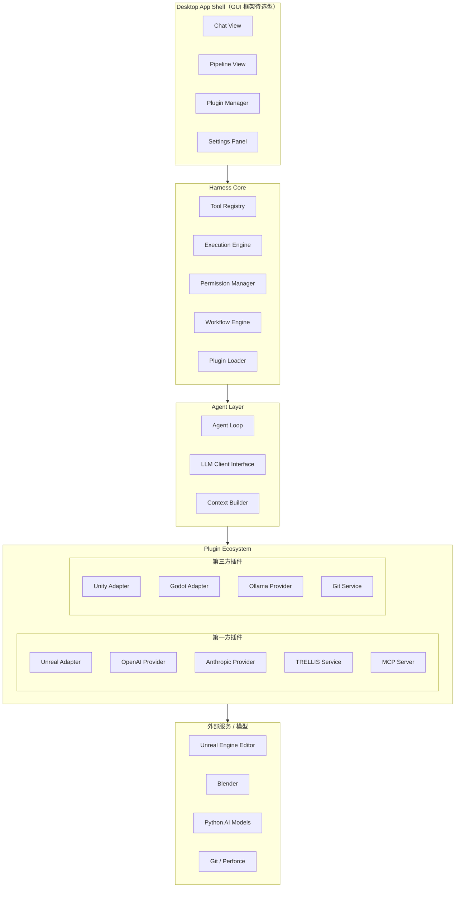

# PRD: Game Dev Harness —— LLM 驱动的游戏开发 Agent 桌面软件

> 版本: v0.1 · 状态: 草案 · 日期: 2026-07-11

---

## 1. Summary

Game Dev Harness 是一个桌面应用，核心理念是 **LLM + Harness = Agent**。Harness 采用 **MCP (Model Context Protocol) 生态优先**策略——不做重复造轮子的引擎 IPC，而是作为 MCP Client 连接已有的 Unreal/Unity/Godot MCP Server（已分别有 62-612 个现成工具）。Harness 的增量价值在于：**多 Agent 协作调度**（Planner → Coder → Asset → Reviewer）、**AI 3D 资产管线编排**、**Sandbox 隔离执行和可逆操作**、**插件市场生态**。

> 技术栈待选型确定，本文档中的具体技术名称（Qt、gRPC、sol3 等）均为候选方案，不代表最终决策。

---

## 2. Contacts

| 角色 | 说明 |
|------|------|
| 产品负责人 | TBD |
| 技术负责人 | TBD |
| 设计负责人 | TBD |

---

## 3. Background

### 3.1 现状与痛点

独立游戏开发者和小团队面临的核心矛盾：**创意无限，但工程资源有限**。

- **资产生产瓶颈**：一个角色从概念到可导入引擎（建模→贴图→绑定→动画），即使使用 AI 工具，仍需在多个平台间手动搬运数据（Meshy → Mixamo → Blender → Unity），流程割裂
- **引擎操作繁琐**：Unity/Unreal/Godot 都是 GUI 重型工具，大量操作（资源导入、Prefab 配置、场景搭建）需要手动点击
- **上下文断裂**：通用 AI 编程助手不了解游戏工程的特殊性——不了解 Prefab 层级、不了解 AssetBundle 依赖、不了解物理碰撞配置
- **重复劳动多**：配置 UI 图集、设置碰撞体、调整 LOD、打包 APK——这些每次都要重做

### 3.2 为什么是现在

1. **LLM 能力突破**：Claude/GPT/DeepSeek 等模型已达到可执行复杂多步任务的水平，function calling / tool use 机制成熟
2. **AI 3D 管线成熟**：TRELLIS、TripoSR、MoMask 等开源模型已能产出可用的 3D 资产（见 `AI_3D_Pipeline_Research.md`），但缺乏统一编排层
3. **Agent 范式确立**：OpenAI Codex CLI、Claude Code、Cline 等证明了"LLM + 工具 = 有效 Agent"的模式
4. **游戏引擎 API 完善**：Unreal Engine 已获得源码读取权限，可深入理解引擎内部 API 和扩展点，编写更可靠的 Editor Plugin；Unity Editor Coroutines、Godot GDScript/C# 同样可被外部工具调用

### 3.3 行业对标

| 产品 | 定位 | 与本项目的差异 |
|------|------|----------------|
| Claude Code / Cline | 通用代码 Agent | 不理解游戏工程语义，无引擎集成，无 3D 资产能力 |
| **Aura 15.0 (Ramen)** | 游戏 AI Agent（最直接竞品） | $40M 融资，8 人团队，30K+ 用户。有 Sandbox/Verification Agent/Material Agent。Harness 差异化：开源核心、插件市场、AI 3D 管线编排、去中心化 |
| Unity Muse | Unity 内置 AI | 仅限 Unity，黑盒服务，不开放 |
| Blender MCP | Blender 工具桥接 | 仅解决 Blender 环节，不是全流程 Agent |
| Unreal Engine AI 工具 | 引擎内置/官方 | UE 5.8 内置 MCP，但无 Agent 级编排能力 |
| **Game Dev Harness** | **MCP 生态 + 多 Agent 游戏全流程** | MCP Client 复用已有工具 + 多 Agent 调度 + AI 3D 管线 + Sandbox + 插件市场 |

---

## 4. Objective

### 4.1 产品目标

让独立游戏开发者用自然语言驱动游戏开发全流程——从"生成一个带走路动画的骑士角色并放入场景"到"为所有 UI 按钮添加点击音效"——Agent 自动规划步骤、调用工具、产出结果。

### 4.2 为什么重要

- **对开发者**：把花在工具间搬运、配置、调试上的时间压缩 70%+，聚焦在玩法设计
- **对行业**：降低游戏开发门槛，让不会编程/美术的创作者也能做出可玩的游戏原型

### 4.3 成功指标（OKR）

| Key Result | 衡量方式 | 目标值 |
|------------|----------|--------|
| KR1: Agent 能完成端到端 3D 资产制作 | "生成一个 Low-Poly 角色并导入 Unreal" 端到端成功率 | ≥ 80% |
| KR2: Harness 工具覆盖主流引擎 | 支持 Unreal、Unity、Godot 三个引擎的工具数 | ≥ 15 个/引擎 |
| KR3: 开发者日均使用时长 | App 活跃时长 | ≥ 2h/天 |
| KR4: 社区工具贡献 | 第三方 Harness 插件数 | ≥ 10 |

---

## 5. Market Segment(s)

### 5.1 首要目标用户

**独立游戏开发者 / 2-5 人小团队**

- JTBD (Jobs To Be Done):
  - "我需要快速把创意变成可玩的 Prototype，而不是花两天配环境"
  - "我的美术能力有限，需要 AI 帮我产出能用的 3D 资产"
  - "我不想在 Unity 里手动拖拽 100 个 Prefab，让 Agent 帮我做"
- 约束条件：
  - 预算有限（免费或低价优先）
  - 硬件中等（单卡 8-16GB VRAM）
  - 技术能力中上（会写代码，但不是引擎专家）
  - 偏好开源/可自部署方案

### 5.2 次要目标用户

- **Game Jam 参与者**：48h 极限开发，需要最快速度出成品
- **技术美术 (TA)**：用 Agent 批量处理资产，写自动化脚本
- **游戏设计/策划**：不会写代码，但想验证玩法想法

---

## 6. Value Proposition(s)

### 6.1 用户获益

| 当前困境 | 使用 Harness 后 |
|----------|----------------|
| 在 5+ 个工具间切换搬运资产 | 一句话完成全流程："生成一个精灵弓箭手，带待机和攻击动画，导入 Unreal" |
| 手动配置数百个 Prefab/碰撞体 | Agent 自动遍历项目，批量配置 |
| 看不懂引擎报错，去 Google 搜 | Agent 直接读取日志，定位问题，修改代码 |
| 每次新项目从零搭框架 | Agent 按项目类型生成工程模板（FPS/RPG/2D 平台） |

### 6.2 核心差异化

1. **MCP 生态优先**：不做重复的引擎 IPC——Harness 是 MCP Client，连接 Epic 官方 Unreal MCP (UE 5.8 内置)、Unity-MCP (235+ 工具)、Godot-MCP、Wwise-MCP 等已有 MCP Server。Harness 的增量价值不在底层通信，而在上层编排
2. **多 Agent 协作**：Planner Agent 分解任务 → Coder Agent 生成/修改代码 → Asset Agent 管理 3D 资产管线 → Reviewer Agent 验证变更——分工协作而非单打独斗
3. **AI 3D 管线内置**：把调研文档中的 TRELLIS + MoMask + Mixamo 流程产品化为一键调用
4. **Sandbox 隔离执行**（P0）：所有 Agent 操作在隔离环境中执行，生成文件先写入临时目录，用户确认后合并。支持一键回滚
5. **Harness 可扩展**：插件市场 + MCP Server 配置管理，社区共建工具生态
6. **本地优先**：核心逻辑本地运行，资产不上传第三方

---

## 7. Solution

### 7.1 UX 概要

```
┌──────────────────────────────────────────────────────────┐
│  Game Dev Harness                        [Project: MyRPG] │
├─────────────────────┬────────────────────────────────────┤
│  Chat / Agent View  │  Tool Execution Panel               │
│                     │                                    │
│  User: 为场景中所有 │  [████████████████] Generating...   │
│  敌人添加巡逻动画   │  ✓ 1/3: TRELLIS → knight.glb (3.2s)│
│                     │  ✓ 2/3: MoMask → patrol.bvh (1.8s) │
│  Agent: 我来帮你... │  ⏳ 3/3: Blender rig+export (4.1s) │
│  [▶ Thinking]       │                                    │
│  [✓ Tool: scan_     │  Output: knight_animated.fbx       │
│   scene]            │  Engine: Unreal Engine 5               │
│  [✓ Tool: generate  │                                    │
│   _animation]...    │  [Open in Engine] [Download] [Retry]│
│                     │                                    │
├─────────────────────┴────────────────────────────────────┤
│  Status: Connected · Claude Opus 4 · Tools: 23 loaded    │
└──────────────────────────────────────────────────────────┘
```

三面板布局：
- **左侧**：Agent 对话区（Markdown 渲染、代码高亮、diff 预览）
- **右侧**：工具执行面板（Pipeline 可视化、执行日志、耗时统计）
- **底部**：状态栏（模型、引擎连接状态、已加载工具数）

### 7.2 核心模块与功能

#### 模块 A: Harness Core —— 工具框架

Harness 是赋予 Agent 行动能力的核心，"LLM + Harness = Agent" 中的 Harness 即指此。

| 功能 | 优先级 | 说明 |
|------|--------|------|
| **Tool Registry** | P0 | 统一的工具注册/发现/调用机制。每个 Tool 有 schema（JSON Schema 描述输入输出）、handler（C++ 函数/Lua 脚本）、权限声明 |
| **Tool Execution Engine** | P0 | 沙箱化执行工具调用，支持同步/异步、超时控制、重试、回滚 |
| **Permission System** | P0 | 分层权限：只读（读文件）/ 写入（改代码）/ 系统（执行外部命令）/ 网络。用户可逐工具授权或批量策略。支持**连续执行模式**——用户在安装时/设置中可选择是否允许 Agent 不经逐次确认连续执行多步操作，可随时切换 |
| **Sandbox Engine** | P0 | 隔离执行环境：Agent 的所有文件写入先进入临时隔离区（类似 git worktree），用户审核后合并到项目；支持一键回滚到操作前状态。Sandbox 也用于自动运行 Agent 生成的代码并收集测试结果 |
| **Plugin System** | P1 | 动态加载插件；社区可开发第三方 Harness 工具 |
| **Context Manager** | P0 | 管理项目上下文：当前引擎类型、项目文件树、最近操作历史、用户偏好。注入到 LLM system prompt |
| **Workflow Engine** | P1 | 将多个 Tool 组合为流水线（Pipeline），支持 DAG 依赖（如"生成模型 → 生成贴图 → 绑定骨骼" 串行，"生成动画" 可并行）|

#### 模块 B: MCP Integration —— 引擎与工具接入

> **核心策略**：Harness 不做重复的引擎 IPC。作为 MCP Client 连接已有的 MCP Server 生态。Epic 官方已将 Unreal MCP 内置到 UE 5.8，社区已有完善的 Unity/Godot MCP 实现。

| 功能 | 优先级 | 说明 |
|------|--------|------|
| **MCP Client Core** | P0 | 实现 MCP 协议客户端（stdio 和 SSE/HTTP 传输）。连接 MCP Server，自动发现 tools/resources/prompts，映射为 Harness Tool |
| **Unreal MCP 集成** | P0 | 连接 Epic 官方 Unreal MCP（UE 5.8 内置，localhost:8000/mcp）或社区实现（IvanMurzak 62 工具 / ultimate 133 工具）。自动发现和管理 UE 工具 |
| **Unity MCP 集成** | P1 | 连接 Unity-MCP / GladeKit MCP (235+ 工具) / akiojin (70+ 工具) |
| **Godot MCP 集成** | P1 | 连接 GladeKit MCP for Godot (33 工具) |
| **Wwise MCP 集成** | P2 | 连接 Wwise-MCP (46 工具)，覆盖游戏音频自动化 |
| **MCP Server 管理器** | P0 | 管理已连接的 MCP Server 列表、启停、权限配置、状态监控 |
| **MCP 工具命名空间** | P0 | 不同 MCP Server 的工具通过命名空间隔离（如 `unreal.scene.spawn_actor`、`unity.prefab.create`），Agent 根据项目引擎类型自动加载对应工具集 |

#### 模块 C: Multi-Agent Orchestration —— 多 Agent 协作调度

> **核心策略**：单一 Agent 在游戏开发复杂任务上成功率有限（学术界最佳 ~54.5%）。采用多 Agent 分工协作架构——每个 Agent 专注自己的领域，有独立上下文和工具集，由 Orchestrator 调度。

| Agent | 职责 | 工具集 |
|-------|------|--------|
| **Orchestrator** | 接收用户意图，分解为子任务，调度和协调其他 Agent，汇总结果 | 所有 Agent 的元信息、任务状态查询 |
| **Planner** | 分析任务需求，制定执行计划（先做什么后做什么、哪些可并行），输出结构化任务 DAG | 项目扫描工具、MCP 只读工具、知识库 RAG |
| **Coder** | 生成和修改代码（C++/Blueprint/C#/GDScript），在 Sandbox 中编译验证 | MCP 代码工具、编译器、静态分析 |
| **Asset Agent** | 管理 AI 3D 资产管线（调用 TRELLIS/MoMask/Blender），处理资产导入和配置 | AI 3D Pipeline 工具、MCP 资产导入工具 |
| **Reviewer** | 验证变更——编译是否通过、资产是否合法、是否符合用户意图、Sandbox 测试是否通过 | 编译器、Blueprint 验证器、VLM 视觉验证 |

**工作流示例**（用户说"生成一个骑士角色并放入场景"）：

```
Orchestrator 接收意图
  → Planner 分析：需要 (1) 生成3D模型 (2) 生成动画 (3) 导入引擎 (4) 放入场景
  → Planner 输出 DAG：[(1) 并行 (2)] → (3) → (4)
  → Orchestrator 调度：
       Asset Agent 执行 (1): TRELLIS → knight.glb, MoMask → walk.bvh
       Asset Agent 执行 (2): RigNet → rigging, Blender → retarget
       Coder Agent 执行 (3): MCP 调用 Unreal-MCP 导入资产
       Coder Agent 执行 (4): MCP 调用 Unreal-MCP 在关卡中 Spawn Actor
  → Reviewer 验证：编译通过 ✓, 资产可加载 ✓, 视觉符合描述 ✓
  → Orchestrator 汇总结果 → 展示给用户
```

**Agent 间的通信**：通过 Harness 内部消息总线，结构化 JSON 传递子任务和结果。每个 Agent 有独立的 LLM 上下文窗口（避免上下文污染），通过 Prompt Caching 降低重复 Token 费用。

#### 模块 D: AI 3D Asset Pipeline —— AI 资产管线

基于 `AI_3D_Pipeline_Research.md` 的调研，将开源模型封装为 Harness 工具。

| 工具 | 底层模型 | 优先级 | 说明 |
|------|----------|--------|------|
| **Text/Image → 3D Model** | TRELLIS / TripoSR | P0 | 从描述或参考图生成 3D 模型（GLB） |
| **Auto Texturing** | Stable Projectorz / Paint3D | P1 | 为模型自动生成 PBR 贴图 |
| **Auto Rigging** | RigNet / Pinocchio | P1 | 自动骨骼绑定 + 蒙皮权重 |
| **Text → Animation** | MoMask / MDM | P1 | 从文本描述生成骨骼动画（BVH） |
| **Video → Animation** | WHAM / ROMP | P2 | 从视频提取人体动作数据 |
| **Animation Retargeting** | Keemap 插件 / 自研 | P1 | 将 BVH 动画重定向到自定义角色骨骼 |
| **3D → Engine Import** | 自研 | P0 | 将产出的 GLB/FBX + 动画一键导入目标引擎 |

Pipeline 示例（内置流水线）：
```
用户输入 "一个穿盔甲的骑士，带行走动画"
  → [TRELLIS] 生成 knight.glb (16s)
  → [Stable Projectorz] 生成 PBR 贴图 (8s)
  → [RigNet] 自动绑定骨骼 (3s)
  → [MoMask] 生成 walk.bvh (2s)
  → [Retargeting] 重定向动画到模型骨架 (1s)
  → [Engine Import] 导入 Unreal，自动创建 Animation Blueprint
  总计: ~30s，全自动
```

#### 模块 E: 服务接入 —— 以第一方插件实现

> **核心原则**：所有外部服务——LLM Provider、MCP Server、AI 模型服务、云存储、版本控制——均以 **第一方插件** 形式实现，通过 Harness Plugin System 加载。Harness Core 本身不内置任何特定服务商的代码。

| 功能 | 优先级 | 说明 |
|------|--------|------|
| **LLM Provider 插件** | P0 | OpenAI / Anthropic / DeepSeek / 通义千问 / Ollama 等各为一个独立插件，用户按需启用 |
| **流式响应** | P0 | SSE streaming，实时显示 Agent 思考过程 |
| **System Prompt 管理** | P0 | 按引擎/项目类型注入不同的 System Prompt 模板 |
| **上下文窗口优化** | P1 | 自动压缩历史、管理工具输出长度、chunk 处理 |
| **多模型协作** | P2 | 快模型做简单任务（文件搜索），强模型做复杂推理（代码生成）|
| **MCP 插件** | P0 | MCP (Model Context Protocol) Server 以第一方插件形式接入，Agent 可通过 MCP 协议调用外部工具和数据源 |
| **AI 3D 服务插件** | P0 | TRELLIS、MoMask 等 AI 模型服务各为独立插件，封装为 Harness Tool；支持本地推理和云端 API 两种模式 |
| **存储/版本控制插件** | P1 | Git、Perforce、云存储（如 COS/OSS）各为独立插件 |

#### 模块 F: Desktop App Shell

| 功能 | 优先级 | 说明 |
|------|--------|------|
| **主窗口框架** | P0 | 原生桌面 GUI（具体 GUI 框架待技术选型），三面板布局。同时提供 CLI/无头模式，Agent 能力可通过命令行调用 |
| **CLI / Headless 模式** | P0 | 与 GUI 共享同一套 Harness Core 和 Agent Layer；支持 `harness run "生成一个骑士模型"` 等纯命令行交互；支持 `harness serve` 作为本地服务运行 |
| **终端/Shell 集成** | P0 | 内嵌终端，Agent 可执行 shell 命令 |
| **文件浏览器** | P0 | 项目文件树，支持拖拽、右键菜单 |
| **Diff Viewer** | P1 | 代码变更前后对比 |
| **插件管理面板** | P0 | 浏览/安装/启用/禁用/卸载插件，查看插件详情和配置 |
| **设置面板** | P0 | LLM API Key、引擎路径、工具权限管理。各插件的配置项在此统一管理 |
| **主题/暗色模式** | P2 | 默认暗色主题 |
| **国际化** | P2 | 中文/英文 |

#### 模块 G: Plugin Marketplace —— 插件市场

插件市场是 Harness 生态的核心分发机制。所有功能扩展——包括引擎 Adapter、LLM Provider、MCP Server、AI 模型服务、第三方工具——均以插件形式通过市场分发。

| 功能 | 优先级 | 说明 |
|------|--------|------|
| **插件索引服务** | P0 | 插件元数据托管于 **GitHub**（索引文件托管于 GitHub 仓库，插件包托管于 GitHub Release），Harness 内置官方索引 URL 指向该仓库。支持用户添加私有索引 URL |
| **插件浏览/搜索** | P0 | 应用内浏览市场插件列表，按分类（引擎/LLM/MCP/AI 模型/工具/主题）、评分、下载量筛选 |
| **一键安装/更新** | P0 | 从外部托管平台下载插件包，自动解压到插件目录，处理依赖 |
| **第一方插件** | P0 | Harness 官方维护的插件（Unreal Adapter、OpenAI Provider、Claude Provider、TRELLIS Service、MCP 基础实现等）——核心仓库由项目组维护，但技术上与其他插件使用同一套 Plugin API，无特殊权限 |
| **第三方插件** | P1 | 社区开发者通过相同的 Plugin API 开发、发布插件，托管于自己的仓库，通过 PR 提交到官方索引文件 |
| **插件配置管理** | P0 | 每个插件的配置项（如 API Key、服务地址、模型参数）在 Harness 设置面板中统一管理，插件只需声明 schema |
| **安全审核** | P1 | 插件安装前展示所需权限（文件读写/网络/引擎操作），用户确认；官方索引中的插件有"已验证"标记 |
| **离线/私有源** | P2 | 支持企业内网私有插件索引，不从公网下载 |

**插件市场架构原则**：
- Harness 本身不托管插件二进制文件，不建中心化应用商店
- 插件实际存储于 GitHub Release / Git 仓库 / 自建服务器等外部平台
- Harness 只维护一个**官方插件索引文件**（JSON/YAML），指向各插件的下载 URL + 校验信息
- 类似 Homebrew Formula 或 VS Code Extension Marketplace 的去中心化模式

### 7.3 技术架构概要



**架构设计原则**：
- **核心层（待选语言）**：Harness Core、Agent Loop、Tool Execution Engine 采用系统级语言实现
- **引擎 Adapter**：Unreal 享有源代码级集成深度（C++ Editor Plugin），Unity 用 C# Editor Plugin，Godot 用 GDExtension
- **AI 模型桥接**：Python 生态的 AI 模型通过 IPC 桥接（具体 IPC 方案待选型）
- **GUI 框架**：待技术选型确定（候选方向包括原生 GUI 框架、Web 前端壳等），选型标准：跨平台、富文本渲染、插件管理 UX
- **插件系统**：第一方和第三方插件使用完全相同的 Plugin API；支持原生编译插件和脚本插件两种模式
- **插件市场**：去中心化模型——Harness 只维护插件索引文件，插件二进制托管于外部平台（GitHub Release 等）
- **MCP**：Model Context Protocol 以第一方插件接入，Agent 通过 MCP 协议与外部工具/数据源交互

### 7.4 核心假设

| # | 假设 | 置信度 |
|---|------|--------|
| A1 | 独立开发者愿意为"能省时间的 Agent"付费或使用 | 中 |
| A2 | LLM 的 tool-calling 能力足以可靠地完成多步游戏开发任务（≤10 步） | 中高 |
| A3 | AI 3D 模型质量已能满足独立游戏 Prototype 阶段需求 | 中高 |
| A4 | 游戏引擎的 Editor API 足够稳定且可被外部程序调用（Unreal 有源码权限，风险大幅降低） | 中高 |
| A5 | 去中心化插件市场（插件索引 + 外部托管）模型能被开发者和用户接受 | 中 |
| A6 | 社区开发者愿意为 Harness 贡献第三方插件 | 低 |
| A7 | 以第一方插件形式接入 LLM Provider / MCP / AI 服务的技术方案可行且性能可接受 | 中高 |

---

## 8. Release Plan

### Phase 1: MVP（2-3 个月）

**目标**：在 Unreal Engine 上跑通 MCP 生态 + 单 Agent + Sandbox 的闭环。

- Harness Core：Tool Registry + Execution + Permission + **Sandbox Engine** 最小可用
- **MCP Client Core**：实现 MCP 协议客户端，连接 Epic 官方 Unreal MCP (UE 5.8)
- Harness 核心工具（不靠 MCP 的）：项目扫描、文件操作、Shell 执行
- **Sandbox Mode**（P0）：隔离执行环境，所有 Agent 写操作先入隔离区，用户确认后合并，支持一键回滚
- **Planner Agent**：单一 Agent 负责分析任务 + 调用工具（Phase 1 暂不做多 Agent）
- 第一方插件：OpenAI Provider、Anthropic Provider、MCP Server 管理器
- 2 个 AI 3D 工具：TRELLIS → 模型 + MoMask → 动画（以第一方插件形式）
- 基础 UI：Chat + Pipeline 面板 + Sandbox 变更审核面板
- 平台：Windows 优先

### Phase 2: Multi-Agent & Multi-Engine（2-3 个月）

- **Multi-Agent Orchestration**：引入 Coder Agent + Asset Agent + Reviewer Agent 分工架构
- AI 3D Pipeline 完整流水线（模型→贴图→绑定→动画→导入）
- Unity MCP 集成 + Godot MCP 集成
- Wwise-MCP 集成
- 插件市场（Plugin Marketplace）：官方插件索引 + 应用内浏览/安装/更新
- 更多第一方插件：Ollama Provider、DeepSeek Provider 等
- 第三方插件 API 文档 + 开发工具链
- Diff Viewer、内嵌终端
- GameDevBench 风格自动化评估流水线

### Phase 3: Ecosystem & Polish（2-3 个月）

- 社区插件生态培养
- GameCoder-27B 等专用模型接入评估
- 多模型协作（Router Agent——小模型处理简单路由，大模型做复杂推理）
- macOS / Linux 支持
- 国际化
- 性能优化（大项目支持）
- 插件安全审核机制

---

## Appendix: 术语表

| 术语 | 定义 |
|------|------|
| **Harness** | 赋予 Agent 行动能力的工具框架：工具注册、执行引擎、权限管控、上下文管理 |
| **Tool** | Harness 中的最小可调用单元，有 schema + handler |
| **Adapter** | 连接特定引擎的桥接层，统一 Harness Tool 与引擎 API 的接口 |
| **Pipeline** | 多个 Tool 按 DAG 组合的自动化工作流 |
| **Agent Loop** | "LLM 思考 → 决定调 Tool → 执行 → 拿结果 → 再思考" 的循环 |
| **第一方插件** | Harness 官方维护的插件（引擎 Adapter、LLM Provider、MCP、AI 服务等），与第三方插件使用同一 Plugin API，无特殊权限 |
| **MCP** | Model Context Protocol，LLM 与外部工具/数据源交互的开放协议，以第一方插件形式接入 Harness |
| **插件索引文件** | JSON/YAML 格式的插件目录，指向各插件的外部托管下载地址 + 校验信息，Harness 通过此文件发现可安装的插件 |
| **外部托管平台** | 插件实际安装包的存储位置（GitHub Release / Git 仓库 / 自建服务器），Harness 本身不托管插件文件 |
